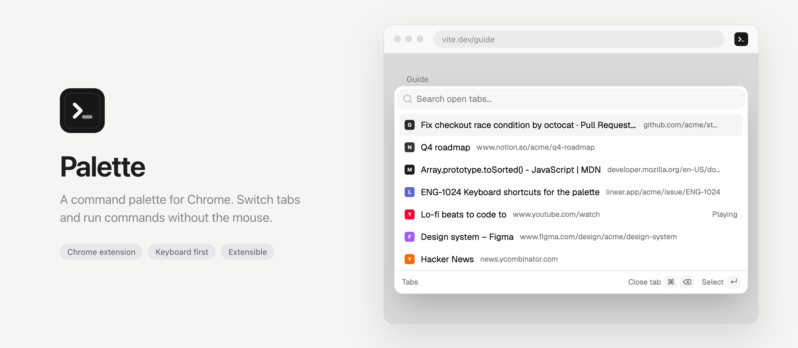
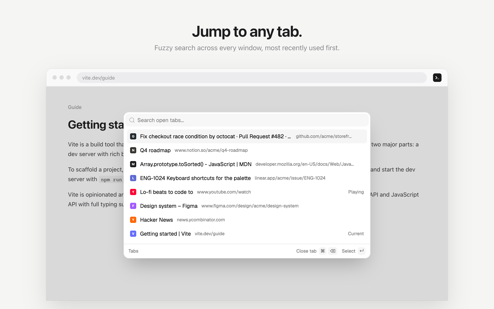
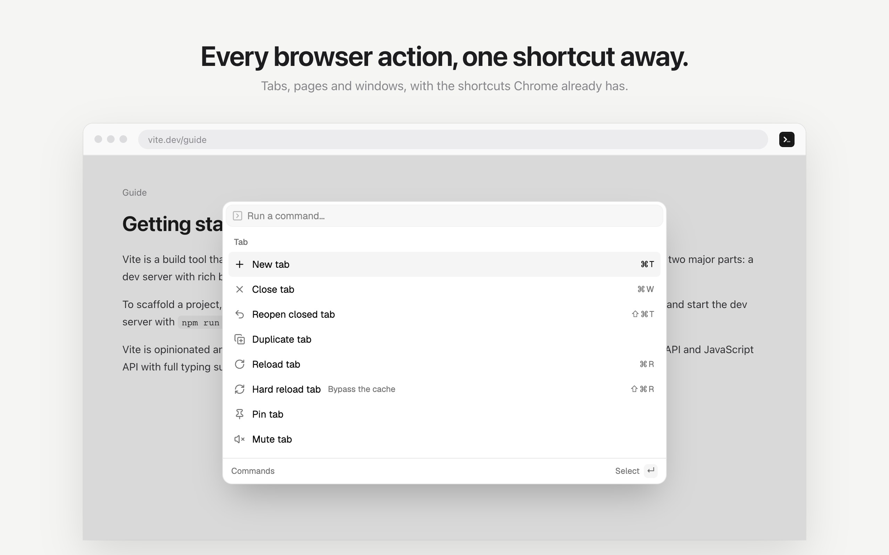
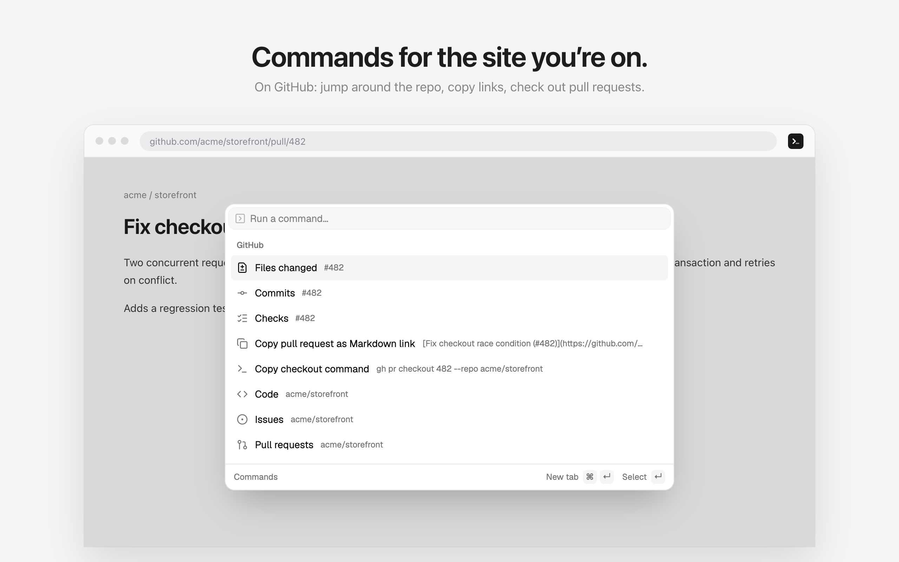

<picture>
  <source media="(prefers-color-scheme: dark)" srcset="docs/banner-dark.png" />
  
</picture>

<p align="center">
  <a href="#install">Install</a> ·
  <a href="#features">Features</a> ·
  <a href="#keyboard">Keyboard</a> ·
  <a href="#site-commands">Site commands</a> ·
  <a href="#plugins">Plugins</a> ·
  <a href="#how-it-works">How it works</a> ·
  <a href="#development">Development</a>
</p>

<br />

Code editors have a command palette: one shortcut, type a few letters, done. This Chrome extension brings it to the browser. **⌘⇧P** jumps to any open tab, and **⌘⇧K** runs any browser action.

<p align="center">
  <picture>
    <source media="(prefers-color-scheme: dark)" srcset="docs/screenshot-tabs-dark.png" />
    
  </picture>
  <picture>
    <source media="(prefers-color-scheme: dark)" srcset="docs/screenshot-commands-dark.png" />
    
  </picture>
</p>

## Features

- **Tab switcher.** Fuzzy search every open tab across all your windows, most recently used first. Hold ⌘⇧ and tap P to walk down the list, then let go to switch, just like in VS Code.
- **Commands.** About 30 actions for tabs, pages and windows: duplicate, pin, mute, reopen closed tab, close duplicates, move to another window, copy the URL as a Markdown link, zoom, and more. Chrome's own shortcuts are shown next to them, so you learn them as you go.
- **Site commands.** Commands for the site you're on, for 19 sites: GitHub, Jira, Google Docs, YouTube and more. Turn each one on or off in settings.
- **Page tools.** On any page: copy the URL without tracking parameters, go up a level, open it in the Wayback Machine, search the site.
- **Open or search anything.** Type a domain to open it, or any text to search with your default search engine.
- **Isolated from the page.** The palette runs in its own frame, so site styles can't break it and it can't break the site.
- **Works everywhere.** On pages extensions can't touch, like `chrome://` pages and the new tab page, it opens from the toolbar instead.
- **Light and dark**, following your system.
- **Extensible.** Everything in the list comes from a [plugin](#plugins). Other extensions can add their own commands too, once you approve them.
- **Private.** Everything happens on your device. No network requests, no analytics, no data collected. Plugins you approve see the current tab's title and address when the palette asks them for commands.

## Install

Until it's on the Chrome Web Store:

1. **[Download the latest release](https://github.com/ytarfa/palette/releases/latest/download/palette.zip)** and unzip it
2. Open `chrome://extensions` and turn on **Developer mode**
3. Click **Load unpacked** and pick the unzipped folder

To update, download the new release, unzip it over the same folder, and click the reload button on Palette's card in `chrome://extensions`. All releases are listed on the [releases page](https://github.com/ytarfa/palette/releases).

Requires Chrome 127 or later.

<details>
<summary>Or build it from source</summary>

<br />

```sh
git clone https://github.com/ytarfa/palette.git
cd palette
pnpm install
pnpm build
```

Then load the `dist` folder the same way.

</details>

## Keyboard

| Key | |
| --- | --- |
| <kbd>⌘</kbd><kbd>⇧</kbd><kbd>P</kbd> | Search tabs. Press P again while holding ⌘⇧ to move down the list, let go to switch |
| <kbd>⌘</kbd><kbd>⇧</kbd><kbd>K</kbd> | Run a command. Press again to close |
| <kbd>></kbd> | At the start of a tab search, switches to commands |
| <kbd>⌘</kbd><kbd>⌫</kbd> | Close the highlighted tab |
| <kbd>↵</kbd> | Run the item, or open its sub-list (items with a ›) |
| <kbd>⌫</kbd> | On an empty search, go back a level, or from commands back to tabs |
| <kbd>Esc</kbd> | Go back a level, or close |

On Windows and Linux, use Ctrl instead of ⌘. You can change both shortcuts at `chrome://extensions/shortcuts`.

## Site commands

When you're on a site Palette knows, its commands show up at the top of ⌘⇧K:

<p align="center">
  <picture>
    <source media="(prefers-color-scheme: dark)" srcset="docs/screenshot-github-dark.png" />
    
  </picture>
</p>

| Site | |
| --- | --- |
| Amazon | Copy clean product links, check price history and reviews, jump to orders and cart |
| AWS Console | Switch regions, jump to common services, copy region codes and Lambda function names |
| Confluence | Edit pages, view page history, copy page links and jump to spaces |
| Figma | Copy clean file and selection links, switch to Dev Mode, present prototypes |
| GitHub | Jump around repositories, copy pull request links and checkout commands |
| GitLab | Jump around projects, copy merge request links and checkout commands (self-hosted too) |
| Google Docs | Download documents, spreadsheets and slides in any format, make a copy, copy clean links |
| Google Search | Filter results by date, switch tabs, and run the same search elsewhere |
| HubSpot | Jump to CRM lists, tasks and inbox, copy record IDs and links |
| Jira | Copy issue keys, branch names and links, jump to boards, backlogs and searches |
| Linear | Copy issue links and branch names, jump to your team's issues and cycles |
| Localhost | Switch ports, protocol and host on local dev servers |
| Netlify | Jump between project pages, open the live site and deploy permalinks |
| Notion | Copy clean page links, page IDs and Markdown links, open pages in the desktop app |
| npm | Copy install commands, jump to package tabs, check bundle size and security |
| Reddit | Copy clean post links, switch to old Reddit, sort and search subreddits |
| Vercel | Jump between project and team pages, copy deployment IDs |
| X | Copy clean post links and IDs, jump to profile tabs, search a user's posts |
| YouTube | Copy short and timestamped video links, change playback speed, open Shorts as regular videos |

<kbd>⌘</kbd><kbd>↵</kbd> opens a page in a new tab instead. Almost everything comes from the tab's address and title, so site commands need no extra permissions and keep working when a site changes its design. The exceptions are YouTube's playback speed and current-time link, which read the video player.

Every site can be turned on or off in **Palette settings** (in ⌘⇧K, or right-click the toolbar icon → Options).

### Adding a site

Each site is one file in [`src/plugins/sites`](src/plugins/sites), picked up automatically. [`github.ts`](src/plugins/sites/github.ts) is a good template, and [`site-kit.ts`](src/plugins/site-kit.ts) has the helpers:

```ts
export default defineSite({
  id: "example",
  name: "Example",
  description: "Jump to the dashboard, copy item links",
  url: "https://example.com",
  matches: (url) => url.hostname === "example.com",
  commands: ({ url, tab }) => [
    navigate("dashboard", "Dashboard", "https://example.com/dashboard", { icon: LayoutDashboard }),
    copy("copy-link", "Copy clean link", url.origin + url.pathname, { icon: Link }),
  ],
})
```

Add a test next to it ([`github.test.ts`](src/plugins/sites/github.test.ts) shows how) and run `pnpm test`.

## Plugins

Everything in the palette comes from a plugin, and the built-in features are plugins too ([`src/plugins`](src/plugins)). A plugin can add:

| | |
| --- | --- |
| **Commands** | Actions listed under ⌘⇧K |
| **Sources** | Items for any list, optionally reloaded as you type |
| **Modes** | New top-level lists, with a prefix to switch to them, like `>` |
| **Children** | A nested list instead of an action, like "Move tab to window…" |
| **Actions** | Extra shortcuts on the highlighted item, like ⌘⌫ to close a tab |

A command takes a few lines:

```ts
// src/plugins/hello.ts
import { Type } from "lucide-react"
import { definePlugin } from "@/core/types"

export default definePlugin({
  id: "hello",
  name: "Hello",
  commands: [
    {
      id: "copy-title",
      title: "Copy page title",
      group: "Page",
      icon: Type,
      when: (ctx) => !!ctx.tab?.title,
      run: (ctx) => ctx.copy(ctx.tab!.title!),
    },
  ],
})
```

Then add it to the list in [`src/plugins/index.ts`](src/plugins/index.ts).

<details>
<summary>A new mode: search bookmarks with <code>@</code></summary>

<br />

This one also needs the `bookmarks` permission in `public/manifest.json`.

```ts
export default definePlugin({
  id: "bookmarks",
  name: "Bookmarks",
  modes: [{ id: "bookmarks", name: "Bookmarks", placeholder: "Search bookmarks…", prefix: "@" }],
  sources: [
    {
      mode: "bookmarks",
      dynamic: true, // reload on every keystroke
      async items(ctx) {
        if (!ctx.query) return []
        const results = await chrome.bookmarks.search(ctx.query)
        return results
          .filter((b) => b.url)
          .map((b) => ({
            id: b.id,
            title: b.title,
            subtitle: b.url,
            run: () => void chrome.tabs.create({ url: b.url }),
          }))
      },
    },
  ],
})
```

</details>

The full API is in [`src/core/types.ts`](src/core/types.ts).

### Plugins from other extensions

Chrome extensions can't download code, so a published Palette can't load plugins the way an editor does. Instead, a plugin is its own extension that talks to Palette through Chrome's extension messaging. The [`@palette/sdk`](packages/sdk) package handles that:

```ts
// The plugin extension's service worker
import { definePalettePlugin } from "@palette/sdk"

definePalettePlugin({
  name: "Toolbox",
  description: "UUIDs, timestamps and encoders",
  commands: [
    { id: "uuid", title: "Copy new UUID", run: () => ({ copy: crypto.randomUUID() }) },
  ],
})
```

1. When the plugin is installed, it registers its commands with Palette. Palette's toolbar icon shows a badge.
2. **Allow “Toolbox” to add commands** appears at the top of ⌘⇧K. <kbd>↵</kbd> allows it, <kbd>⌘</kbd><kbd>⌫</kbd> blocks it.
3. Its commands show up in the list. Picking one asks the plugin to run it, and the plugin can reply with something for Palette to do, like copying text or opening a page.

The plugin's code stays in its own extension, with its own permissions and its own Web Store review. Palette checks everything a plugin sends, and only shows icons embedded in the plugin itself. **Manage plugins…** in ⌘⇧K lists plugins so you can turn them on or off, or remove them.

See the [SDK's README](packages/sdk) for the full API, and [`examples/toolbox`](examples/toolbox) for a complete plugin to load next to Palette.

### Shortcuts next to commands

Chrome doesn't let extensions read its keyboard shortcuts, so the ones in the list come from [`src/config/shortcuts.json`](src/config/shortcuts.json). It maps command ids to Chrome's default shortcuts, taken from [Google's list](https://support.google.com/chrome/answer/157179), and plugins don't need to set anything:

```json
{
  "tab-commands:new": "mod+t",
  "tab-commands:back": { "mac": "mod+[", "other": "alt+arrowleft" }
}
```

`mod` is ⌘ on macOS and Ctrl elsewhere. Write `plus`, `minus` and `comma` for those keys. These shortcuts are only displayed: pressing them is still handled by Chrome.

## How it works

When you press ⌘⇧P or ⌘⇧K:

1. Chrome passes the shortcut to the background worker. It's an extension shortcut, so it works on every page and takes priority over the page's own shortcuts.
2. The worker asks the tab's content script to open the palette. If the tab can't run one (`chrome://` pages, the new tab page, the Web Store), it opens the palette as the toolbar popup instead.
3. The content script shows the palette in an iframe, inside a closed shadow root. The page's CSS, fonts and key handlers can't reach it. The frame is created the first time and then kept hidden, so it opens instantly after that.
4. The palette is an extension page, so built-in plugins call the `chrome.*` APIs directly. Plugins from other extensions are asked for their items over `chrome.runtime` messaging.

Tabs that were open before the extension was installed get the content script injected on install, so there's no need to reload them.

## Development

TypeScript, Vite, React, Tailwind CSS v4 and [shadcn/ui](https://ui.shadcn.com)'s `Command` component, built on [cmdk](https://cmdk.paco.me).

```
public/manifest.json   Manifest V3 config, including the keyboard shortcuts
src/background/        Service worker: routes shortcuts, popup fallback
src/content/           Content script: shows and hides the palette frame
src/palette/           The palette UI (palette.html), in the page frame or the popup
src/core/              Plugin API, registry, modes and keyboard helpers
src/plugins/           Everything the palette lists
src/plugins/sites/     One file per site, registered automatically
src/options/           Settings page (options.html)
src/config/            Chrome's default shortcuts, shown next to commands
src/components/ui/     shadcn/ui components
packages/sdk/          @palette/sdk, for plugins in other extensions
examples/toolbox/      Example plugin extension
scripts/               README image rendering
docs/                  README banners and screenshots
```

| Script | |
| --- | --- |
| `pnpm dev` | Rebuilds `dist/` on every change |
| `pnpm build` | Builds the SDK, typechecks, then builds `dist/` |
| `pnpm --filter palette-toolbox build` | Builds the example plugin into `examples/toolbox/dist/` |
| `pnpm test` | Runs the tests (Vitest) |
| `pnpm lint` | Lints with oxlint |
| `pnpm render:readme` | Re-renders the images in `docs/` with your installed Chrome, using the real palette from `dist/` and a set of demo tabs |

### Continuous integration and releases

- **Pull requests** run lint, typecheck, tests and both builds ([`ci.yml`](.github/workflows/ci.yml)). A pull request can't be merged into `main` until they pass.
- **Every push to `main`** that changes the extension runs the same checks, then publishes a release with the built extension as `palette.zip` ([`release.yml`](.github/workflows/release.yml)). Pushes that only touch docs don't release. A release can also be started by hand from the Actions tab.
- **Versions** are `major.minor.patch`: major and minor come from `public/manifest.json`, so bump those there for a bigger release. The patch number counts up on each release, and the release's `manifest.json` gets the full version.

### Working on it

After a rebuild, click the reload button on the extension's card in `chrome://extensions`. Open tabs pick up the new content script automatically.

The manifest pins Palette's extension ID to `jcjopjoglbklaejmahmfnhmanfoomnpk` when loaded unpacked, so plugins can find it. The Chrome Web Store will assign a different one, which `PALETTE_ID` in the SDK will then need to use.

To regenerate the icons after editing `public/icons/icon.svg`:

```sh
cd public/icons && for s in 16 32 48 128; do rsvg-convert -w $s -h $s icon.svg -o $s.png; done
```

## License

[MIT](LICENSE)
